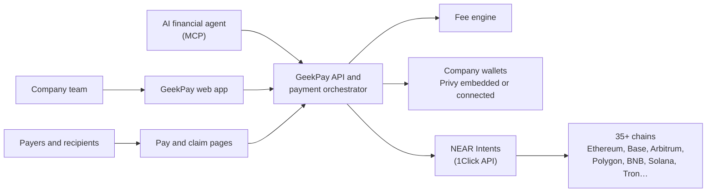

# GeekPay

**An AI-native finance platform for businesses that run on crypto.**

Companies pay their team, contractors and suppliers in stablecoins across 35+ chains, send invoices that clients pay by link with any token, and see everything in one place. An AI financial agent runs these payments, with the team's approval or on its own within a budget account the company funds and can revoke.

[geekpay.co](https://www.geekpay.co) · [X](https://x.com/Geekpayco) · [LinkedIn](https://www.linkedin.com/company/geekpay) · ostap@geekpay.co

> GeekPay is live. The relaunch, a major update, ships in mid-December 2026. This repository holds the public overview of the product and its architecture; the product code is private.

---

## What it does

| | |
|---|---|
| **Payroll and payouts** | Pay many people in one approval, in the token and on the chain each of them wants. |
| **Send** | Pay any address. The sender says what the recipient gets; GeekPay converts from whatever the company holds, so nobody bridges or swaps by hand. |
| **Invoices** | Billed in USD and paid by link. The payer picks any supported token and chain and gets a one-time deposit address; the company receives what was paid, or has it converted to one token on one chain. |
| **Checks** | Send money without knowing the recipient's address. The recipient claims it by link to any wallet or exchange address. Until it's claimed, the sender can pull it back, and an unclaimed Check returns on its own. |
| **Private payments, on request** | A company can make a payment confidential, so salaries don't end up public on-chain. It is a per-payment choice, never on by default. |
| **Reports** | Every payment in one place, with categories and exports. |
| **AI financial agent** | Works with the team's approval, or on its own from a separate budget account (see below). |

## How it works

- **Settlement: NEAR Intents.** All value movement runs on NEAR Intents, which is in production. It routes stablecoins and other assets across 35+ chains and delivers them on the chain the recipient wants. The recipient never needs a gas token.
- **Sign-in and wallets.** Privy: email, social sign-in, and EVM and Solana wallets, plus NEAR wallet sign-in. One wallet per account. Payments from a company's wallet are always signed by that wallet.
- **Fee engine.** One fee function for every payment type; nothing is hard-coded per screen. Wallet-to-wallet sends are free.
- **AI financial agent.** It works through an MCP server over GeekPay's payment API, so it isn't tied to one model. In autonomous mode it pays only from a budget account the company funds, caps and can revoke; it can never touch the company's main wallet. Rules (per-payment cap, allowed recipients, schedule) are checked before every payment the agent signs.

## Principles

- **Non-custodial.** GeekPay never takes ownership of client funds and can't move them on its own.
- **Recipients need nothing.** No gas token, no GeekPay account: an address or a claim link is enough.
- **Final means final.** Sends, payouts and paid invoices are final. Only a Check can be pulled back, and only before it is claimed.
- **Opt-in privacy.** Confidential payments are a choice made per payment.

## Roadmap

| When | What |
|---|---|
| Mid-December 2026 | The relaunch: payments across 35+ chains, invoices paid by link, Checks, private payments on request, reports |
| Q1 2027 | AI financial agent |
| Q2 2027 | Public API for platforms, Pro plan for teams |
| Q3 2027 | Fiat in and out through licensed partners (the partner holds the fiat, never GeekPay) |

## Team

- **Ostap Harasymchuk**, CEO: built CPAY's crypto payment and wallet infrastructure; now sets GeekPay's product.
- **Valery Krasovsky**, co-founder: co-founded Sigma Software in 2002 and leads it as Group CEO.

GeekPay's engineering team is in Ukraine.

## Contact

Ostap Harasymchuk · ostap@geekpay.co · [geekpay.co](https://www.geekpay.co)
